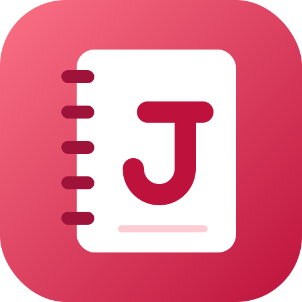
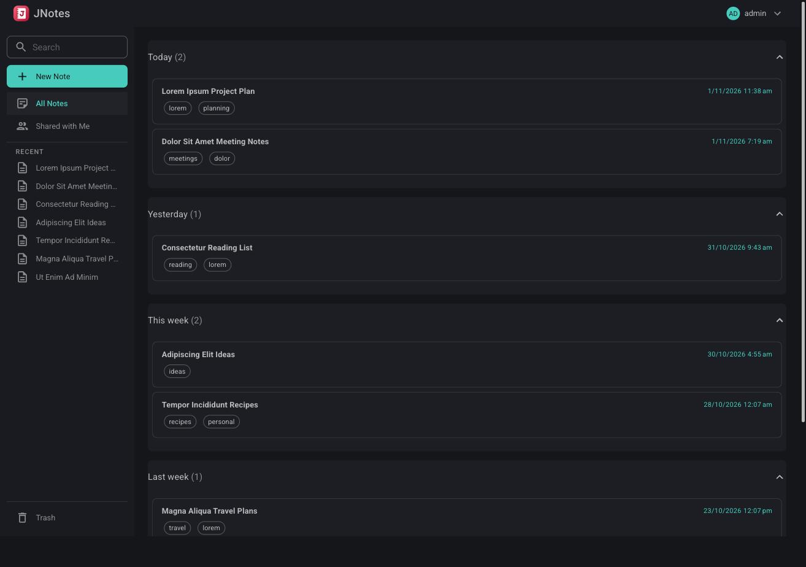
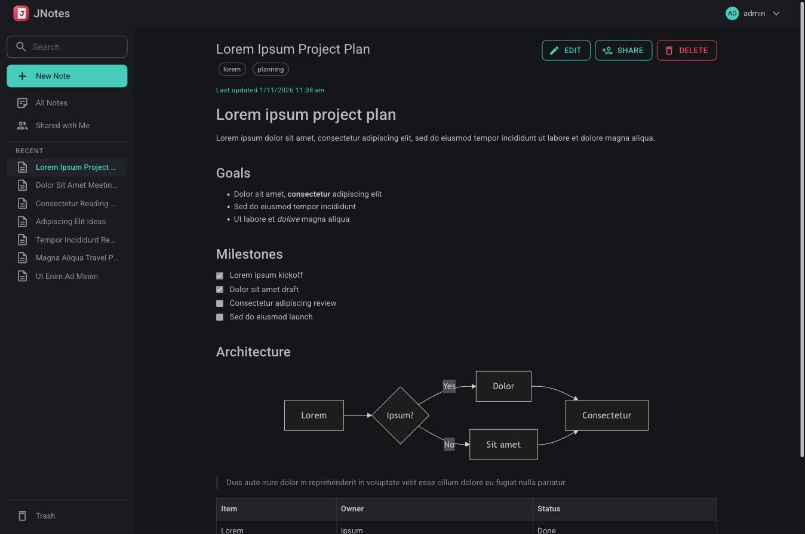
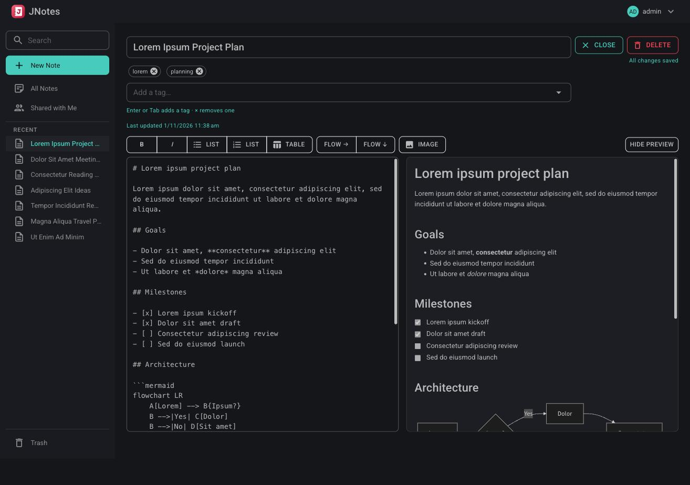

<p align="center">
  
</p>

<h1 align="center">JNotes</h1>

<p align="center">
  <strong>A self-hosted, multi-user note-taking app. Your notes stay plain markdown files you own.</strong>
</p>

<p align="center">
  <a href="https://github.com/joeldroid/JNotes/actions/workflows/ci.yml"></a>
  <a href="https://github.com/joeldroid/JNotes/actions/workflows/docker-publish.yml"></a>
  
  
  
  
</p>

<p align="center">
  <a href="#features">Features</a> ·
  <a href="#quick-start">Quick start</a> ·
  <a href="docs/README.md">Documentation</a>
</p>

---

JNotes is built with Blazor Server (.NET 10). Notes are stored
as portable markdown files on disk — copy the folder and every note is a readable `.md` file in
any editor. A single PostgreSQL database holds user accounts and settings, and the note index that
makes notes fast to search/list; the index tables are a derived cache, never the source of truth —
the markdown files always are.

The very first time you run JNotes, you'll land on a setup screen to create the admin account —
see [Authentication](docs/authentication.md) for that flow, adding more users, and OIDC.

## Screenshots

<p align="center">
  
  <br>
  <em>Your notes, grouped by when they were last updated, with search and a Recent list in the sidebar.</em>
</p>

<p align="center">
  
  <br>
  <em>Reading a note: markdown, task lists and mermaid diagrams.</em>
</p>

<p align="center">
  
  <br>
  <em>Editing with a markdown toolbar and a live preview. Changes are saved automatically.</em>
</p>

## Features

- **Notes** — free-form markdown, edited with a live preview, with `mermaid` code blocks rendered as diagrams (toolbar buttons insert a starter flow chart), and images inserted with the **Image** button or by pasting one (PNG, JPEG, GIF or WebP, up to 10 MB).
- **Task lists** — markdown task lists (`- [ ] item` / `- [x] item`) render as read-only checkboxes in previews and in the PDF export; edit the markdown to change them.
- **PDF export (optional)** — an **Export PDF** button on a note opens it as a light-themed A4 PDF (images and diagrams included), rendered by a [Gotenberg](https://gotenberg.dev) container. Off unless `GOTENBERG_URL` is set.
- **Auto-tagging (optional)** — when `OLLAMA_URL` points at an [Ollama](https://ollama.com) server, a background task tags notes that have no tags using a local model (Microsoft's `phi4` by default). It never changes tags you've written.
- **Note sharing (Read/Edit)** — share a single note with any other user, as view-only or editable (body only); shared notes appear in **All Notes**, in search and on a **Shared with Me** page. See [Sharing notes](docs/sharing.md).
- **Multi-user with real accounts** — admin-created users, each with their own notes and settings;
  sign in with a password, OIDC, or both.
- **Portable storage** — every note is `notes/<user-id>/<id>.md` with a small YAML front matter
  header (title, tags, timestamps) followed by the markdown body.
- **Recent notes and Trash** — the sidebar lists your ten most recently updated notes, with **Trash** pinned to the bottom; deleting a note moves it to Trash until you delete it permanently.
- **Responsive UI** — [MudBlazor](https://mudblazor.com) (Material design) with a dark theme, usable on both desktop and mobile.
- **Self-healing index** — the note index is reconciled against the notes folder at startup and
  on demand (Administration → Rescan Now), so edits made directly to the files (outside the app, or
  while the container was stopped) are picked up automatically.

## Quick start

With Docker, using the [sample `docker-compose.yml`](docker-compose.yml) (starts JNotes and PostgreSQL):

```bash
docker compose up --build
```

JNotes is then at `http://localhost:8080`.

The compose file builds the image from source. To use a prebuilt image instead, pull it from either registry (`linux/amd64`, tagged `latest`, a build version, or a release version):

| Registry | Image |
| --- | --- |
| [Docker Hub](https://hub.docker.com/r/joeldroid/jnotes) | `joeldroid/jnotes` |
| [GitHub Container Registry](https://github.com/joeldroid/JNotes/pkgs/container/jnotes) | `ghcr.io/joeldroid/jnotes` |

```bash
docker pull joeldroid/jnotes
# or
docker pull ghcr.io/joeldroid/jnotes
```

In the sample compose file, replace `build: .` on the `jnotes` service with `image: joeldroid/jnotes:latest` (or `image: ghcr.io/joeldroid/jnotes:latest`) and run `docker compose up`.

Without Docker you need the [.NET 10 SDK](https://dotnet.microsoft.com/download) and a PostgreSQL database:

```bash
dotnet run --project src/JNotes.Web
```

See [Running with Docker](docs/docker.md) and [Running locally](docs/running-locally.md) for details.

## Documentation

Full documentation lives in [`docs/`](docs/README.md):

| Page | What's in it |
| --- | --- |
| [Running locally](docs/running-locally.md) | .NET SDK setup, PostgreSQL, first run |
| [Running with Docker](docs/docker.md) | Compose setup, volumes, file permissions |
| [Configuration](docs/configuration.md) | Every environment variable, Data Protection keys, backups |
| [Authentication](docs/authentication.md) | First-run setup, users, OIDC |
| [Sharing notes](docs/sharing.md) | Read/Edit sharing and what each permission allows |
| [PDF export](docs/pdf-export.md) | Optional Gotenberg setup |
| [Auto-tagging](docs/auto-tagging.md) | Optional Ollama setup, behaviour and privacy |
| [Note file format](docs/file-format.md) | The on-disk markdown and front matter |
| [Development](docs/development.md) | Project layout, styling, tests, CI |
