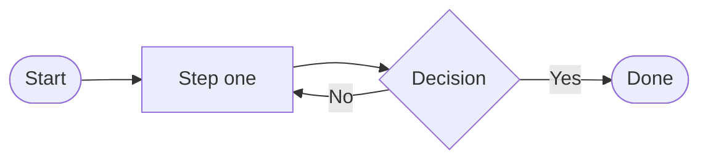
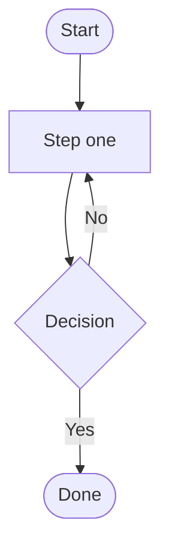

# Plan: Mermaid flow charts in text notes (JNotes)

**Status:** Ready for implementation. No code written yet.
**Scope:** `JNotes.Core` (markdown pipeline), `JNotes.Web` (preview component, toolbar, vendored JS, CSS), tests, `README.md`.
**Author context:** planned against commit `199cdfa` (`main`, clean tree). Save as `docs/plans/mermaid-flowcharts-in-text-notes.md` (matches the existing `docs/plans/auto-index.md`, `docs/plans/checklist-ui-add-and-reorder.md`).

> **Note on `CLAUDE.md`:** §10 proposes edits. Those are **held for the user's approval** — the executor must NOT touch `CLAUDE.md` unless the user explicitly confirms. `README.md` updates are in scope.

---

## 1. Goal, scope, non-goals

**Goal**

1. A fenced code block with the `mermaid` info string inside a **text note's** body renders as a diagram everywhere text notes are previewed — `/notes/{id}` (`NoteView.razor`) and the right-hand preview pane of the editor (`TextNoteEditor.razor`). Both go through `MarkdownPreview.razor`, so this is one code path.
2. Two new buttons on the text-note edit screen's toolbar insert a starter flow chart: **left-to-right** (`flowchart LR`) and **top-to-bottom** (`flowchart TD`), using the existing toolbar insertion plumbing so autosave/debounce keeps working unchanged.

**Verified current state (read, not assumed)**

| Concern | Today |
| --- | --- |
| Markdown → HTML | `src/JNotes.Core/Serialization/MarkdownRenderer.cs`, singleton (`ServiceCollectionExtensions.cs:92`), static `MarkdownPipeline` = `UsePipeTables().DisableHtml()`. Markdig **1.3.2** (`src/JNotes.Core/JNotes.Core.csproj:10`). |
| Preview component | `src/JNotes.Web/Components/Notes/MarkdownPreview.razor` — 16 lines: injects `IMarkdownRenderer`, recomputes `_html` in `OnParametersSet`, renders `@((MarkupString)_html)` inside `<div class="markdown-preview">`. No JS, no `@ref`, no lifecycle beyond `OnParametersSet`. |
| Preview call sites | Exactly two: `TextNoteEditor.razor:17` and `NoteView.razor:60`. `Trash.razor` and `NoteListItem.razor` never render a body. |
| Toolbar | `src/JNotes.Web/Components/Notes/MarkdownToolbar.razor` — one `<div class="btn-group">` with B / I / ☰ List / 1. List / Table; lazily imports `./js/markdown-toolbar.js`, disposes the module ref catching `JSDisconnectedException`. Used only by `TextNoteEditor.razor:2`. |
| Toolbar JS | `src/JNotes.Web/wwwroot/js/markdown-toolbar.js` — ESM with `wrapSelection`, `insertAtCursor`, `toggleBulletList`, `toggleOrderedList`; every function ends with `fireInput()` (focus + dispatch a bubbling `input` event) so Blazor's `@oninput` sees it as a keystroke. |
| Body change path | `TextNoteEditor.OnInput` → `BodyChanged` → `NoteEditor.razor:51` `@bind-Body:after="OnContentEdited"` → 800 ms content debounce → `NoteService.AutosaveAsync(ContentOnly)`. |
| Static assets | `App.razor` links `@Assets["lib/bootstrap/dist/css/bootstrap.min.css"]` etc.; `Program.cs:128` `app.MapStaticAssets()`. `wwwroot/lib/` contains only `bootstrap/dist/{css,js}` (committed, incl. `.map`s). |
| Theme | `App.razor` prerenders `<html data-bs-theme="@_theme">` (dark default). `Settings.razor:350` changes it live via `document.documentElement.setAttribute("data-bs-theme", …)` — **no page reload**. |
| CSS | `wwwroot/css/app.css` `@import`s `variables.css`, `blazor-template.css`, `note-editor.css`, `note-list.css`, `nav-menu.css`. `.markdown-preview img` / `table` styles currently live in `note-editor.css`. Native nesting (`&`), no build step. |
| Existing interop precedent | `MarkdownToolbar` (module import + `JSDisconnectedException`), `ChecklistPanel.OnAfterRenderAsync` (focus). |

**Non-goals (explicitly out of scope)**

* Mermaid in **checklist** notes (`ChecklistNoteEditor` has no `MarkdownPreview` by design) or in the note list / trash list.
* Diagram types beyond what mermaid supports out of the box — no allow-list; any mermaid diagram in a ````mermaid` fence will render. Only the two *toolbar templates* are flowcharts.
* Server-side (headless) diagram rendering, export to PNG/SVG, click/`securityLevel: 'loose'` interactivity, pan/zoom, or a diagram WYSIWYG editor.
* Matching the app font/Bootstrap colours inside diagrams beyond mermaid's own `dark`/`default` themes.
* Any change to the note file format: a mermaid diagram is an ordinary fenced code block, so the `.md` stays portable (GitHub, Obsidian, VS Code all render ````mermaid` fences too).

---

## 2. Design decisions

### D1 — Mermaid is **vendored** under `wwwroot/lib/mermaid/`, not loaded from a CDN

**Decision:** commit `src/JNotes.Web/wwwroot/lib/mermaid/dist/mermaid.min.js` (the self-contained UMD bundle) plus `src/JNotes.Web/wwwroot/lib/mermaid/LICENSE`, pinned to **mermaid 11.17.2**.

**Rationale**

* JNotes is self-hosted and frequently run on a LAN/air-gapped box or behind a strict CSP; a CDN reference makes diagrams silently break offline and leaks every user's IP/referrer to a third party. The app already ships Bootstrap this way for the same reason, so "Bootstrap is the only vendored UI dependency under `wwwroot/lib/`" is a *statement of current fact*, not a prohibition on a second one — and mermaid is exactly the same kind of dependency (precompiled browser asset, no build step, no Node).
* Docker images must be reproducible; a pinned committed file cannot change under the app.
* **UMD single file, not the ESM build** (verified against the npm tarball): `dist/mermaid.esm.min.mjs` is a 29 KB entry that imports **104 separate chunk files** (5.4 MB total) from `dist/chunks/mermaid.esm.min/`. Vendoring 105 files with relative inter-chunk imports is far more fragile than one file. `dist/mermaid.min.js` is fully self-contained (verified: zero `chunks/` references) and ends with `globalThis["mermaid"] = globalThis.__esbuild_esm_mermaid_nm["mermaid"].default;`, i.e. a classic script that defines `window.mermaid`.
* **Version pin 11.17.2 (2026-08-25), not 12.0.0 (2026-09-10):** 12.0.0 is a 10-day-old major, and its UMD bundle is 5.3 MB (1.6 MB gzip) versus 11.17.2's 3.4 MB (956 KB gzip). Take the mature line and the smaller payload.
* **No `.map` file** (unlike the vendored Bootstrap): it would add megabytes for no runtime benefit. Verified safe — `mermaid.min.js` contains **no** `sourceMappingURL` comment, so browsers won't even request one.

**Accepted cost:** ~3.4 MB added to the repo and the published image. Mitigated by D2 (it is never fetched unless a note actually contains a diagram) and by `MapStaticAssets`, which pre-compresses it at build time and serves it with a content-hash ETag.

**Executor commands (run from repo root):**

```bash
mkdir -p src/JNotes.Web/wwwroot/lib/mermaid/dist
curl -fsSL https://cdn.jsdelivr.net/npm/mermaid@11.17.2/dist/mermaid.min.js \
  -o src/JNotes.Web/wwwroot/lib/mermaid/dist/mermaid.min.js
curl -fsSL https://cdn.jsdelivr.net/npm/mermaid@11.17.2/LICENSE \
  -o src/JNotes.Web/wwwroot/lib/mermaid/LICENSE
# Sanity checks (both must pass before committing):
ls -l src/JNotes.Web/wwwroot/lib/mermaid/dist/mermaid.min.js      # ~3.4 MB
tail -c 80 src/JNotes.Web/wwwroot/lib/mermaid/dist/mermaid.min.js  # globalThis["mermaid"] = …
```

If the machine has no network, fail loudly and stop — do **not** substitute a CDN `<script>` tag.

### D2 — Mermaid is loaded **lazily, on first use**, by a JNotes ESM module

**Decision:** nothing about mermaid goes into `App.razor`. A new ESM module `wwwroot/js/mermaid-preview.js` injects `<script src="…/lib/mermaid/dist/mermaid.min.js">` into `<head>` the first time a diagram is actually found, and memoizes the load promise. `MarkdownPreview` only imports that module when its rendered HTML contains a mermaid block.

**Rationale:** users who never write a diagram never download 3.4 MB; the note list, settings, login etc. are untouched; and the module import itself is the same lazy pattern `MarkdownToolbar` already uses. Resolve the URL as `new URL('lib/mermaid/dist/mermaid.min.js', document.baseURI).href` so it keeps working if `<base href>` ever stops being `/`.

### D3 — Markdig emits `<pre class="mermaid">…</pre>`, HTML-escaped

**Decision:** a new Markdig extension replaces the built-in `CodeBlockRenderer` so a fenced block whose info string is `mermaid` (case-insensitive) renders as `<pre class="mermaid">ESCAPED SOURCE</pre>` instead of the default `<pre><code class="language-mermaid">…</code></pre>`. Everything else falls through to `base.Write`.

**Rationale**

* `.mermaid` on a `<pre>` is mermaid's own canonical hook; the JS gets one stable element to own, instead of having to unwrap a nested `<pre><code>` and decide which node to replace.
* It keeps the "does this note have a diagram?" test in C# trivial and exact (`_html.Contains("<pre class=\"mermaid\">")`), which is what drives D2's lazy import.
* It is **unit-testable in `JNotes.Tests`** without a browser — which matters a lot here, because the repo has no bUnit and this is the only part of the feature that *can* be tested automatically.
* Emitting the diagram source as **escaped text content** (not an attribute, not raw) is the XSS story: `.DisableHtml()` already neuters raw HTML in note bodies, and `escape: true` means a body containing `</pre><script>alert(1)</script>` inside a mermaid fence comes out as `&lt;/pre&gt;&lt;script&gt;…`, so it cannot break out of the block. The JS reads the source back via `element.textContent`, which decodes the entities, so mermaid still sees the author's exact text. **Verified by running this exact renderer against Markdig 1.3.2** — output was `<pre class="mermaid">flowchart LR\n A[&quot;&lt;/pre&gt;&lt;script&gt;alert(1)&lt;/script&gt;&quot;]\n</pre>`.
* Second layer: mermaid runs with `securityLevel: 'strict'` (D5), which DOMPurify-sanitizes the SVG it produces and disables `click`/script directives inside a diagram.

**Markdig facts verified by compiling and running against 1.3.2** (do not re-litigate these):

* `CodeBlockRenderer` is `Markdig.Renderers.Html.CodeBlockRenderer`; override `protected override void Write(HtmlRenderer renderer, CodeBlock obj)`.
* `renderer.WriteLeafRawLines(obj, writeEndOfLines: true, escape: true)` is the escaping writer (extension method, `using Markdig.Renderers.Html;`).
* `html.ObjectRenderers.Replace<CodeBlockRenderer>(new MermaidCodeBlockRenderer())` works.
* `MarkdownPipelineBuilder.Use<TExtension>()` works for a `public sealed class … : IMarkdownExtension` with a parameterless ctor.
* `FencedCodeBlock.Info` is the **first word** of the info string, so ` ```mermaid theme=dark ` still matches; `~~~mermaid` (tilde fence) also matches; fences inside list items work; ` ```mermaid ` with no content yields `<pre class="mermaid"></pre>` (the JS must skip empty sources — see D4).
* **Name-collision gotcha:** the new extension lives in `namespace JNotes.Core.Serialization`, which already contains JNotes's own `IMarkdownRenderer`. The `IMarkdownExtension.Setup` overload takes **Markdig's** `IMarkdownRenderer`, so the parameter type **must be written fully qualified as `Markdig.Renderers.IMarkdownRenderer`** or the class won't implement the interface. (Verified: it compiles with the qualification.)

### D4 — Re-render policy: interop on every render, with an element stamp + an SVG cache

**Problem.** `MarkupString` is opaque to Blazor's diff: when `_html` changes by a single character, Blazor removes the whole markup subtree and inserts a new one. In the editor that happens on **every keystroke**, destroying every rendered diagram each time. Naively re-rendering with mermaid per keystroke is both slow (mermaid parse + layout) and visibly flickery.

**Decision — three mechanisms, all in `mermaid-preview.js`:**

1. **Element stamp.** After rendering, set `el.dataset.mermaidKey = theme + "\0" + source`. On each pass, an element already stamped with the current key is skipped entirely. This makes the common case (a re-render that didn't change the markdown, e.g. a title keystroke) free.
2. **Module-level SVG cache** `Map<key, svgString>`, capped at 50 entries (FIFO eviction). On each pass, a *new* element whose key is already cached gets its SVG injected **synchronously**, in the same interop call — so a keystroke elsewhere in the body repaints existing diagrams with no async gap and effectively no flash.
3. **Debounce for genuinely new work** (250 ms per container, `WeakMap<container, timeoutId>`). Only diagrams whose source actually changed hit mermaid, and only once the user pauses — so typing *inside* a fence doesn't spawn a parse per character. While debounced, the block shows its own source styled as a muted code block (D7), which doubles as live feedback.

Supporting details:

* Source is preserved in `el.dataset.mermaidSource` before the source text is replaced by the SVG, so a later theme-driven re-render (D6) can still find it.
* Sources that are empty/whitespace after trimming are skipped (stamped, left as-is) — ` ```mermaid ` with an empty body must not reach `mermaid.parse`.
* Before applying an SVG, check `el.isConnected`; if Blazor replaced the markup mid-render the result is still cached, so the next pass applies it synchronously.
* No generation counter or cancellation token is needed: every apply re-derives the key from the live element, so a late result can never overwrite a newer diagram.
* `MarkdownPreview` calls `renderDiagrams(container)` from `OnAfterRenderAsync` on **every** render (not just `firstRender`) but **only when `_html` contains a mermaid block** — the stamp makes repeat calls nearly free, and skipping when there's no diagram keeps mermaid unloaded for ordinary notes (D2).

### D5 — Mermaid config, errors, and "interactivity only exists on a circuit"

* `mermaid.initialize({ startOnLoad: false, securityLevel: 'strict', theme })`, re-called only when the theme actually changes (tracked in a module variable). `startOnLoad: false` stops mermaid scanning the document on its own — JNotes drives every render.
* Render with `await mermaid.parse(source, { suppressErrors: true })` first, then `await mermaid.render(id, source)`. `parse` with `suppressErrors` returns falsy instead of throwing, which avoids mermaid's "error bomb" SVG and its leftover temp nodes. Still wrap in `try/catch`, and defensively `document.getElementById('d' + id)?.remove()` in a `finally` (mermaid appends a temporary `#d<id>` measuring element to `<body>` and can leave it behind on failure).
* `bindFunctions` from `mermaid.render` is deliberately **not** called — it only wires `click` handlers, which `securityLevel: 'strict'` disables anyway.
* **On a parse/render error:** put the source text back (`el.textContent = source`), add class `mermaid-error`, set `el.title = message`, and **still stamp `data-mermaid-key`** so a broken diagram is retried only when its source (or the theme) changes — no retry-per-render loop. A bad diagram therefore degrades to "your source, flagged", never a blank page and never an exception that escapes into Blazor.
* **Interactivity:** JS is invoked only from `OnAfterRenderAsync`, which never runs during static SSR/prerender, so there is no "JS interop during prerendering" exception. Both hosts of `MarkdownPreview` sit on `InteractiveServer` pages — `App.razor` chooses static SSR only for `/login` and `/setup`, which never render a note. If a note were ever rendered statically in future, diagrams degrade to visible source (D7), not an error.
* Diagrams are rendered **in the browser**, so nothing about this increases the Blazor Server circuit payload: the SVG never crosses the wire.

### D6 — Theme: read `data-bs-theme` in JS, key the cache by it, watch for changes

**Decision:** the JS module derives mermaid's theme from `document.documentElement.dataset.bsTheme` (`'dark'` → mermaid `'dark'`, anything else → mermaid `'default'`), includes it in the cache/stamp key, and installs a one-time `MutationObserver` on `<html>` filtered to `data-bs-theme`. On a change it clears every `data-mermaid-key` stamp and re-runs the pass over every `.markdown-preview` in the document.

**Rationale:** `Settings.razor` flips the attribute live via JS with **no page reload**, and Blazor keeps the same `<html>` element across in-app navigation, so a server-side theme parameter would go stale. Reading the DOM makes the C# side theme-agnostic (no new parameter, no `ISettingsService` call in `MarkdownPreview`) and correct in the prerender case too, because `App.razor` has already written the right attribute into the initial HTML. The observer is belt-and-braces (the toggle lives on `/settings`, which shows no preview), but it is ~10 lines and removes a whole class of "diagram stayed light on a dark page" bugs. The cache is **not** cleared on theme change — the key contains the theme, so both variants coexist and switching back is instant.

### D7 — Unrendered blocks show their source (no hiding)

**Decision:** CSS styles `pre.mermaid:not([data-mermaid-key])` (and `.mermaid-error`) as a muted monospace code block rather than hiding it.

**Rationale:** hiding would mean a permanently invisible diagram whenever JS is unavailable — vendored file missing from the image, CSP block, circuit never connected, a future static-SSR surface. Showing the source is honest, degrades gracefully, and the visible window is short (prerender → circuit connect, or the 250 ms debounce). `text-align: center` on rendered blocks, `left` on source blocks.

### D8 — Toolbar: two plain buttons in a second `btn-group`, templates as C# consts, reuse `insertAtCursor`

* **Where:** `MarkdownToolbar.razor`'s root becomes `<div class="d-flex flex-wrap gap-2">` holding two `btn-group`s — the existing formatting group, and a new "Diagrams" group with the two buttons. Seven buttons in one group would overflow awkwardly on mobile; two groups wrap as units. The component is still a single flex item inside `TextNoteEditor`'s existing `d-flex … flex-wrap gap-2` header row, so nothing else moves. `ChecklistNoteEditor` deliberately has no toolbar and is unaffected.
* **Labels:** `Flow →` and `Flow ↓` with `title`/`aria-label` "Insert a left-to-right flow chart" / "Insert a top-to-bottom flow chart". Plain Unicode glyphs, consistent with `NavMenu`'s icon rule; U+2192/U+2193 have no emoji presentation, so no U+FE0E dance is needed.
* **Templates:** two `private const string` raw-string literals in `MarkdownToolbar.razor` beside the existing `SampleTable` — snippet text belongs with the component that inserts it, and the JS module stays generic DOM plumbing. Two separate consts rather than one parameterised template, because the flowchart body contains `{Decision}` braces, which would force an awkward `$$"""…"""` interpolated raw string.
* **Insertion + cursor:** reuse the existing `insertAtCursor(textarea, text)` unchanged — caret lands immediately after the inserted block, exactly like the Table button, and `fireInput()` dispatches a real `input` event so `TextNoteEditor.OnInput` → `BodyChanged` → `NoteEditor.OnContentEdited` → the 800 ms content debounce fires with no new C# plumbing. **No new JS function.** (A fancier "insert and select the first node label" variant is explicitly rejected: it would need a new JS export and diverge from every other button. Noted as a possible follow-up in §11/R6.)
* Both templates start with two newlines and end with one, mirroring `SampleTable`, so the fence always begins on its own line with a blank line above it.

---

## 3. Files to create / modify

| # | Path | Action |
| --- | --- | --- |
| 1 | `src/JNotes.Core/Serialization/MermaidCodeBlockRenderer.cs` | **New** — `CodeBlockRenderer` subclass emitting `<pre class="mermaid">`. |
| 2 | `src/JNotes.Core/Serialization/MermaidMarkdownExtension.cs` | **New** — `IMarkdownExtension` that installs #1. |
| 3 | `src/JNotes.Core/Serialization/MarkdownRenderer.cs` | Modify — add `.Use<MermaidMarkdownExtension>()` to the pipeline + comment. |
| 4 | `src/JNotes.Web/wwwroot/lib/mermaid/dist/mermaid.min.js` | **New (vendored, 11.17.2)**. |
| 5 | `src/JNotes.Web/wwwroot/lib/mermaid/LICENSE` | **New (vendored, MIT)**. |
| 6 | `src/JNotes.Web/wwwroot/js/mermaid-preview.js` | **New** — ESM module: lazy mermaid load, render pass, cache, theme observer. |
| 7 | `src/JNotes.Web/Components/Notes/MarkdownPreview.razor` | Modify — `@ref` container, `_hasMermaid`, `OnAfterRenderAsync` interop, `IAsyncDisposable`. |
| 8 | `src/JNotes.Web/Components/Notes/MarkdownToolbar.razor` | Modify — two buttons + two template consts + two-group layout. |
| 9 | `src/JNotes.Web/wwwroot/css/mermaid.css` | **New** — diagram block styling. |
| 10 | `src/JNotes.Web/wwwroot/css/app.css` | Modify — one `@import url("mermaid.css");`. |
| 11 | `tests/JNotes.Tests/Serialization/MarkdownRendererTests.cs` | Modify — add the mermaid cases (§8). |
| 12 | `README.md` | Modify — Features, Styling/vendored-libs, Note file format. |
| 13 | `CLAUDE.md` | **HELD — only with explicit user approval** (§10). |

Nothing else changes: no new NuGet package (Markdig is already in Core), no `Program.cs`/DI change, no `BannedSymbols.txt` change (the Web side touches only `IJSRuntime`, `ElementReference`, `IJSObjectReference` — none banned), no `Dockerfile`/`docker-compose.yml` change, no new env var.

---

## 4. Exact changes, per file

### 4.1 `src/JNotes.Core/Serialization/MermaidCodeBlockRenderer.cs` (new)

```csharp
using Markdig.Renderers;
using Markdig.Renderers.Html;
using Markdig.Syntax;

namespace JNotes.Core.Serialization;

/// <summary>
/// Renders a ```mermaid fenced block as &lt;pre class="mermaid"&gt;source&lt;/pre&gt; instead of
/// Markdig's default &lt;pre&gt;&lt;code class="language-mermaid"&gt;, so the browser-side mermaid
/// module (wwwroot/js/mermaid-preview.js) has one stable element to swap for an SVG. Every other
/// code block falls through to the base renderer untouched.
/// The source is written with escape: true — a note body is untrusted input, and DisableHtml()
/// elsewhere in the pipeline would otherwise be trivially bypassed by a "&lt;/pre&gt;&lt;script&gt;"
/// inside a mermaid fence. The JS reads it back with textContent, which decodes the entities, so
/// mermaid still sees exactly what the author typed.
/// </summary>
public sealed class MermaidCodeBlockRenderer : CodeBlockRenderer
{
    private const string MermaidInfo = "mermaid";

    protected override void Write(HtmlRenderer renderer, CodeBlock obj)
    {
        if (obj is FencedCodeBlock fenced &&
            string.Equals(fenced.Info?.Trim(), MermaidInfo, StringComparison.OrdinalIgnoreCase))
        {
            renderer.Write("<pre class=\"mermaid\">");
            renderer.WriteLeafRawLines(obj, writeEndOfLines: true, escape: true);
            renderer.WriteLine("</pre>");
            return;
        }

        base.Write(renderer, obj);
    }
}
```

### 4.2 `src/JNotes.Core/Serialization/MermaidMarkdownExtension.cs` (new)

```csharp
using Markdig;
using Markdig.Renderers;
using Markdig.Renderers.Html;

namespace JNotes.Core.Serialization;

/// <summary>Installs <see cref="MermaidCodeBlockRenderer"/> into the HTML renderer.</summary>
public sealed class MermaidMarkdownExtension : IMarkdownExtension
{
    // Nothing to add to the parser: a mermaid diagram is an ordinary fenced code block, which is
    // exactly why a note file stays portable (GitHub/Obsidian render ```mermaid fences too).
    public void Setup(MarkdownPipelineBuilder pipeline)
    {
    }

    // NOTE: the parameter type must stay fully qualified. This namespace already has JNotes's own
    // IMarkdownRenderer, and an unqualified name would bind to that and silently fail to implement
    // IMarkdownExtension.
    public void Setup(MarkdownPipeline pipeline, Markdig.Renderers.IMarkdownRenderer renderer)
    {
        if (renderer is HtmlRenderer html)
        {
            html.ObjectRenderers.Replace<CodeBlockRenderer>(new MermaidCodeBlockRenderer());
        }
    }
}
```

### 4.3 `src/JNotes.Core/Serialization/MarkdownRenderer.cs` (modify)

Add one builder call and extend the existing comment:

```csharp
    private static readonly MarkdownPipeline Pipeline = new MarkdownPipelineBuilder()
        .UsePipeTables()
        .DisableHtml()
        // ```mermaid fences become <pre class="mermaid"> for the browser-side renderer to pick up;
        // the source is HTML-escaped, so this is not a hole in DisableHtml().
        .Use<MermaidMarkdownExtension>()
        .Build();
```

### 4.4 `src/JNotes.Web/wwwroot/js/mermaid-preview.js` (new)

Complete intended implementation (the riskiest piece — write it as given, adjusting only style):

```js
// Renders ```mermaid blocks in MarkdownPreview.razor. Markdig emits <pre class="mermaid">SOURCE</pre>
// (escaped); this module swaps the source for an SVG.
//
// Vendored mermaid 11.17.2 (MIT) lives at wwwroot/lib/mermaid/dist/mermaid.min.js — a self-contained
// UMD bundle that defines window.mermaid. It's injected on first use rather than from App.razor, so
// notes without diagrams never download 3.4 MB.
//
// The awkward part is Blazor: a MarkupString is opaque to its diff, so ANY change to the rendered
// HTML (every keystroke in the editor) tears down the whole preview subtree and rebuilds it,
// destroying rendered diagrams. Hence three mechanisms below: an element stamp (skip work when the
// same element already shows this source+theme), an SVG cache (repaint a rebuilt element
// synchronously, so there's no flash), and a debounce (only genuinely new source reaches mermaid).

const DEBOUNCE_MS = 250;
const CACHE_LIMIT = 50;

const svgCache = new Map();          // key -> svg string
const pendingTimers = new WeakMap(); // container element -> timeout id
let mermaidPromise = null;
let configuredTheme = null;
let themeObserved = false;
let idCounter = 0;

function currentTheme() {
    return document.documentElement.getAttribute('data-bs-theme') === 'dark' ? 'dark' : 'default';
}

function keyFor(theme, source) {
    return theme + '\u0000' + source;
}

function sourceOf(element) {
    // Cached on the element because rendering replaces the text content with the SVG, and a theme
    // change has to be able to re-render from the original source.
    if (element.dataset.mermaidSource === undefined) {
        element.dataset.mermaidSource = element.textContent ?? '';
    }
    return element.dataset.mermaidSource;
}

function cacheSvg(key, svg) {
    if (svgCache.size >= CACHE_LIMIT) {
        svgCache.delete(svgCache.keys().next().value);
    }
    svgCache.set(key, svg);
}

function applySvg(element, key, svg) {
    if (!element.isConnected) {
        return;
    }
    element.innerHTML = svg;
    element.classList.remove('mermaid-error');
    element.removeAttribute('title');
    element.dataset.mermaidKey = key;
}

function applyError(element, key, message) {
    if (!element.isConnected) {
        return;
    }
    element.textContent = sourceOf(element);
    element.classList.add('mermaid-error');
    element.title = message || 'The diagram could not be rendered.';
    // Stamped anyway: a broken diagram should be retried when its source (or the theme) changes,
    // not on every single re-render.
    element.dataset.mermaidKey = key;
}

function loadMermaid() {
    mermaidPromise ??= new Promise((resolve, reject) => {
        const script = document.createElement('script');
        script.src = new URL('lib/mermaid/dist/mermaid.min.js', document.baseURI).href;
        script.onload = () => resolve(window.mermaid);
        script.onerror = () => {
            mermaidPromise = null; // let a later attempt retry
            reject(new Error('Failed to load mermaid.'));
        };
        document.head.appendChild(script);
    });
    return mermaidPromise;
}

function configure(mermaid, theme) {
    if (configuredTheme === theme) {
        return;
    }
    // securityLevel 'strict' is mermaid's default and is kept explicitly: it sanitizes the SVG it
    // produces and disables click/script directives inside a diagram.
    mermaid.initialize({ startOnLoad: false, securityLevel: 'strict', theme });
    configuredTheme = theme;
}

function observeTheme() {
    if (themeObserved) {
        return;
    }
    themeObserved = true;
    // Settings -> Dark mode flips data-bs-theme live with no reload, and Blazor keeps the same
    // <html> element across in-app navigation, so the DOM is the only reliable source of truth.
    new MutationObserver(() => {
        if (currentTheme() === configuredTheme) {
            return;
        }
        for (const element of document.querySelectorAll('pre.mermaid[data-mermaid-key]')) {
            delete element.dataset.mermaidKey;
        }
        for (const container of document.querySelectorAll('.markdown-preview')) {
            renderDiagrams(container);
        }
    }).observe(document.documentElement, { attributes: true, attributeFilter: ['data-bs-theme'] });
}

async function renderPending(container) {
    const theme = currentTheme();
    let mermaid;
    try {
        mermaid = await loadMermaid();
        configure(mermaid, theme);
    } catch (error) {
        for (const element of container.querySelectorAll('pre.mermaid')) {
            applyError(element, keyFor(theme, sourceOf(element)), error.message);
        }
        return;
    }

    for (const element of container.querySelectorAll('pre.mermaid')) {
        const source = sourceOf(element);
        const key = keyFor(theme, source);
        if (element.dataset.mermaidKey === key || source.trim() === '') {
            element.dataset.mermaidKey = key; // an empty fence is "done", not an error
            continue;
        }

        const cached = svgCache.get(key);
        if (cached !== undefined) {
            applySvg(element, key, cached);
            continue;
        }

        const id = 'mermaid-' + (idCounter++);
        try {
            // suppressErrors: parse returns falsy instead of throwing mermaid's "error bomb" SVG.
            const valid = await mermaid.parse(source, { suppressErrors: true });
            if (!valid) {
                applyError(element, key, 'Invalid mermaid syntax.');
                continue;
            }
            const { svg } = await mermaid.render(id, source);
            cacheSvg(key, svg);
            applySvg(element, key, svg);
        } catch (error) {
            applyError(element, key, error?.message);
        } finally {
            // mermaid appends a temporary measuring element to <body> and can leave it behind.
            document.getElementById('d' + id)?.remove();
        }
    }
}

function schedule(container) {
    clearTimeout(pendingTimers.get(container));
    pendingTimers.set(container, setTimeout(() => {
        pendingTimers.delete(container);
        renderPending(container);
    }, DEBOUNCE_MS));
}

export function renderDiagrams(container) {
    if (!container) {
        return;
    }
    observeTheme();

    const theme = currentTheme();
    let needsWork = false;

    // Synchronous first pass: anything already rendered is left alone, and anything whose SVG is
    // cached is repainted right now — that's what keeps a keystroke from flashing the raw source of
    // every other diagram in the note.
    for (const element of container.querySelectorAll('pre.mermaid')) {
        const source = sourceOf(element);
        const key = keyFor(theme, source);
        if (element.dataset.mermaidKey === key) {
            continue;
        }
        const cached = svgCache.get(key);
        if (cached !== undefined) {
            applySvg(element, key, cached);
        } else if (source.trim() === '') {
            element.dataset.mermaidKey = key;
        } else {
            needsWork = true;
        }
    }

    if (needsWork) {
        schedule(container);
    }
}
```

### 4.5 `src/JNotes.Web/Components/Notes/MarkdownPreview.razor` (modify)

```razor
@implements IAsyncDisposable
@inject IMarkdownRenderer MarkdownRenderer
@inject IJSRuntime JSRuntime

<div class="markdown-preview" @ref="_container">
    @((MarkupString)_html)
</div>

@code {
    // Matches exactly what MermaidCodeBlockRenderer emits — the cheap test for "is any JS needed at
    // all", which keeps the 3.4 MB mermaid bundle unloaded for notes without diagrams.
    private const string MermaidBlockMarker = "<pre class=\"mermaid\">";

    [Parameter, EditorRequired] public string Markdown { get; set; } = "";

    private string _html = "";
    private bool _hasMermaid;
    private ElementReference _container;
    private IJSObjectReference? _module;

    protected override void OnParametersSet()
    {
        _html = MarkdownRenderer.RenderToHtml(Markdown);
        _hasMermaid = _html.Contains(MermaidBlockMarker, StringComparison.Ordinal);
    }

    // Runs after every render, not just the first: Blazor treats a MarkupString as opaque, so any
    // change to _html (every keystroke in the editor) rebuilds the whole subtree and throws away
    // the rendered SVGs. The JS side skips elements it already rendered and repaints cached ones
    // synchronously, so calling it each time is cheap. Never runs during prerender, which is why
    // there's no "JS interop before the circuit exists" guard here.
    protected override async Task OnAfterRenderAsync(bool firstRender)
    {
        if (!_hasMermaid)
        {
            return;
        }

        try
        {
            _module ??= await JSRuntime.InvokeAsync<IJSObjectReference>("import", "./js/mermaid-preview.js");
            await _module.InvokeVoidAsync("renderDiagrams", _container);
        }
        catch (JSDisconnectedException)
        {
            // The circuit's gone (tab closed / navigated away) — nothing to render into.
        }
    }

    public async ValueTask DisposeAsync()
    {
        if (_module is not null)
        {
            try
            {
                await _module.DisposeAsync();
            }
            catch (JSDisconnectedException)
            {
            }
        }
    }
}
```

### 4.6 `src/JNotes.Web/Components/Notes/MarkdownToolbar.razor` (modify)

Markup — replace the single root `btn-group` with:

```razor
<div class="d-flex flex-wrap gap-2">
    <div class="btn-group" role="group" aria-label="Markdown formatting">
        @* …the five existing buttons, unchanged… *@
    </div>
    <div class="btn-group" role="group" aria-label="Diagrams">
        <button type="button" class="btn btn-sm btn-outline-secondary"
                title="Insert a left-to-right flow chart" aria-label="Insert a left-to-right flow chart"
                @onclick="FlowchartLeftToRightAsync">Flow →</button>
        <button type="button" class="btn btn-sm btn-outline-secondary"
                title="Insert a top-to-bottom flow chart" aria-label="Insert a top-to-bottom flow chart"
                @onclick="FlowchartTopToBottomAsync">Flow ↓</button>
    </div>
</div>
```

Handlers (beside the existing ones, same shape as `TableAsync`):

```csharp
    private async Task FlowchartLeftToRightAsync()
    {
        var module = await GetModuleAsync();
        await module.InvokeVoidAsync("insertAtCursor", TargetTextarea, FlowchartLeftToRight);
    }

    private async Task FlowchartTopToBottomAsync()
    {
        var module = await GetModuleAsync();
        await module.InvokeVoidAsync("insertAtCursor", TargetTextarea, FlowchartTopToBottom);
    }
```

### 4.7 Starter template text (exact)

Two `private const string` raw-string literals beside `SampleTable`, using the **same indentation convention** (content and closing `"""` aligned so the emitted text starts at column 0, with the diagram's own 4-space indents preserved *relative* to that, and two leading blank lines + one trailing newline like `SampleTable`).

Emitted text for **Flow →** (`FlowchartLeftToRight`):

```
(blank line)
(blank line)

(trailing newline)
```

Emitted text for **Flow ↓** (`FlowchartTopToBottom`) — byte-identical except line 1 of the diagram:

```
(blank line)
(blank line)

(trailing newline)
```

Notes for the executor: use a **non-interpolated** raw string (`"""`, not `$"""`) — the `{Decision}` braces are literal. Backticks need no escaping. Verify after editing that `dotnet build` passes and that the inserted text in the browser starts at column 0 (a raw-string indentation mistake shows up as a 4-space-indented fence, which markdown would treat as an indented code block).

### 4.8 `src/JNotes.Web/wwwroot/css/mermaid.css` (new) and `app.css` (modify)

`app.css`: add `@import url("mermaid.css");` after the `note-editor.css` line.

`mermaid.css` (native nesting, matching the house style):

```css
/* Mermaid diagram blocks inside rendered markdown. Markdig emits <pre class="mermaid">SOURCE</pre>
   (see MermaidCodeBlockRenderer); wwwroot/js/mermaid-preview.js swaps the source for an SVG and
   stamps data-mermaid-key on the element once it has. Anything without that stamp hasn't been
   rendered yet (prerender, debounce, or mermaid failed to load) and shows its source instead of
   disappearing. */
.markdown-preview pre.mermaid {
    margin-bottom: 1rem;
    padding: 0;
    background-color: transparent;
    text-align: center;

    &:not([data-mermaid-key]),
    &.mermaid-error {
        text-align: left;
        white-space: pre-wrap;
        font-family: var(--bs-font-monospace, monospace);
        font-size: 0.875em;
        color: var(--bs-secondary-color);
    }

    &.mermaid-error {
        padding-left: 0.75rem;
        border-left: 3px solid var(--bs-warning);

        &::before {
            content: "Diagram error — showing the source.";
            display: block;
            margin-bottom: 0.25rem;
            font-family: var(--bs-body-font-family);
            color: var(--bs-warning-text-emphasis, var(--bs-secondary-color));
        }
    }

    & svg {
        max-width: 100%;
        height: auto;
    }
}
```

### 4.9 `README.md` (modify)

* **Features** — extend the "Text notes" bullet: *"free-form markdown, edited with a live preview, with `mermaid` code blocks rendered as diagrams (toolbar buttons insert a starter flow chart)."*
* **Styling** — the paragraph that currently says Bootstrap is the vendored precompiled asset: add that mermaid is vendored the same way under `wwwroot/lib/mermaid` (pinned 11.17.2, MIT), loaded lazily by the browser only when a note actually contains a diagram, so JNotes still works with no internet access.
* **Note file format** — one sentence: a diagram is just a ` ```mermaid ` fenced code block in the body, so the file stays ordinary markdown that GitHub/Obsidian also render.

---

## 5. Ordered task list for the executor

1. **Core renderer.** Create `MermaidCodeBlockRenderer.cs` and `MermaidMarkdownExtension.cs`, wire `.Use<MermaidMarkdownExtension>()` into `MarkdownRenderer.cs`. Watch the `Markdig.Renderers.IMarkdownRenderer` qualification (D3).
2. **Core tests.** Add the mermaid cases to `tests/JNotes.Tests/Serialization/MarkdownRendererTests.cs` and run `dotnet test tests/JNotes.Tests --filter "FullyQualifiedName~MarkdownRendererTests"` — pure unit tests, **no Redis needed**, so iterate here first. Steps 1-2 are the only part with automated coverage; get them green before touching the UI.
3. **Vendor mermaid.** Run the `curl` commands in D1 and verify size + trailing `globalThis["mermaid"]` line.
4. **JS module.** Create `wwwroot/js/mermaid-preview.js` (§4.4).
5. **CSS.** Create `wwwroot/css/mermaid.css`, add the `@import` to `app.css`.
6. **Preview component.** Rewrite `MarkdownPreview.razor` (§4.5).
7. **Toolbar.** Update `MarkdownToolbar.razor` (§4.6, §4.7).
8. **README** (§4.9). **Skip `CLAUDE.md`** unless the user has approved §10.
9. **Verify** (§7), then the manual browser checklist (§9). If no browser is available, say so explicitly rather than claiming it passed.

Hard ordering: 1 before 2; 3-4 before 6 (the module must exist before the component imports it); 5 any time. 7 is independent of 1-6 and can be done first if preferred.

---

## 6. Behaviour summary (what the user sees)

| Situation | Result |
| --- | --- |
| Text note with a ` ```mermaid ` fence, opened at `/notes/{id}` | Source flashes briefly during prerender → SVG once the circuit connects and mermaid loads (first load ~1 MB gzipped, then browser-cached). |
| Same note in the editor | Left pane: raw markdown, fence and all. Right pane: diagram. |
| Typing elsewhere in the body | Existing diagrams repaint instantly from the SVG cache; no mermaid work. |
| Typing *inside* a fence | Source shows as muted monospace until 250 ms after you stop, then re-renders. |
| Syntactically invalid diagram | Source shown with a warning border and "Diagram error — showing the source."; details in the element's `title`. Page keeps working. |
| Non-mermaid fenced block (` ```csharp `) | Unchanged: `<pre><code class="language-csharp">`. |
| Checklist note | Unchanged — no `MarkdownPreview`, no toolbar, no mermaid. |
| Theme toggled in Settings | mermaid re-initialises and every visible diagram re-renders in the new theme (and switches back instantly from cache). |
| Offline / air-gapped host | Works — the bundle is served by the app itself. |
| Vendored file missing (bad image) | Diagrams degrade to their source with the error styling; nothing else breaks. |

---

## 7. Verification commands (from repo root)

```bash
dotnet build JNotes.slnx
dotnet test tests/JNotes.Tests --filter "FullyQualifiedName~MarkdownRendererTests"   # fast, no Redis
dotnet test JNotes.slnx                       # needs a real Redis on localhost:6379
dotnet format JNotes.slnx --verify-no-changes
dotnet watch --project src/JNotes.Web run     # for the manual checklist below
```

Integration/`Users` suites need a real Redis (`docker run --rm -p 6379:6379 valkey/valkey`, or set `JNOTES_TEST_REDIS_CONNECTION_STRING`); a failure there without one is environmental, not a regression from this change. `dotnet format` does not touch `.js`/`.css`, but `.editorconfig`'s `[*]` rules (UTF-8, trailing-whitespace trim, final newline) apply to the hand-written files — **not** to the vendored `mermaid.min.js`, which must be committed byte-for-byte as downloaded.

Optional extra confidence for the Docker path (per CLAUDE.md's Docker gotcha): `docker compose up --build`, then load a note with a diagram **in a real browser** — a plain `curl` health check cannot detect a missing static asset.

---

## 8. Tests

The project has **no bUnit**, so the Razor/JS half is verified manually (§9). Everything automatable is in Core.

### `tests/JNotes.Tests/Serialization/MarkdownRendererTests.cs` (modify — keep the two existing tests)

Add:

1. `RenderToHtml_renders_a_mermaid_fence_as_a_mermaid_pre_block` — ` ```mermaid\nflowchart LR\n  A --> B\n``` ` → `Assert.Contains("<pre class=\"mermaid\">", html)` and `Assert.DoesNotContain("language-mermaid", html)`.
2. `RenderToHtml_preserves_the_mermaid_source_lines` — the arrow line survives with its line break (expect `A --&gt; B` on its own line; `-->` is escaped to `--&gt;`, and the JS decodes it via `textContent`).
3. `RenderToHtml_escapes_html_inside_a_mermaid_block` — source containing `</pre><script>alert('x')</script>` → `Assert.DoesNotContain("<script>", html)` and `Assert.Contains("&lt;/pre&gt;", html)`. **This is the XSS regression guard; do not drop it.**
4. `RenderToHtml_matches_the_mermaid_info_string_case_insensitively` — ` ```MERMAID ` → `<pre class="mermaid">`.
5. `RenderToHtml_treats_a_mermaid_fence_with_extra_info_arguments_as_mermaid` — ` ```mermaid theme=dark ` (verified: Markdig's `Info` is the first word only).
6. `RenderToHtml_leaves_other_fenced_code_blocks_alone` — ` ```csharp ` → `Assert.Contains("language-csharp", html)` and `Assert.DoesNotContain("class=\"mermaid\"", html)`.
7. `RenderToHtml_leaves_an_indented_code_block_alone` — four-space-indented `flowchart LR` → plain `<pre><code>`, no mermaid class (guards against the raw-string-indentation mistake in §4.7 silently "working").
8. `RenderToHtml_renders_an_empty_mermaid_fence_as_an_empty_block` — ` ```mermaid ` with no body → `<pre class="mermaid"></pre>` (pins the case the JS deliberately skips).
9. Regression: the two existing tests (pipe table, raw HTML encoded) must still pass unchanged.

No integration tests: nothing touches the file store, Redis, or `NoteService` — note bodies are stored verbatim and always were.

---

## 9. Manual browser verification checklist (`dotnet watch --project src/JNotes.Web run`)

1. Create a text note, click **Flow →**: a ` ```mermaid` / `flowchart LR` block is inserted at the cursor with a blank line above it, the textarea keeps focus, the caret sits after the closing fence, and the status line goes "Unsaved changes" → "All changes saved" within ~1 s.
2. The right-hand preview pane shows a real left-to-right diagram (5 nodes, `Yes`/`No` edge labels).
3. Click **Flow ↓** on a new line: a second diagram renders, this one top-to-bottom.
4. Type a long paragraph elsewhere in the body: both diagrams stay rendered — **no flicker, no reversion to source on each keystroke**. (If they flash, the SVG cache or the element stamp in D4 is wrong.)
5. Edit inside one fence (e.g. rename `Step one`): that block shows its source while typing and re-renders ~250 ms after you stop; the *other* diagram never flickers.
6. Break the syntax deliberately (e.g. `flowchart LR\n A --< B`): the block shows the source with a warning border and the "Diagram error" line; hovering shows the message; **the rest of the page and autosave keep working**; fixing it re-renders.
7. Click **Done** → `/notes/{id}`: the read-only view shows the same diagrams. Reload the page: they render again (brief flash of source during prerender is expected).
8. Settings → toggle **Dark mode** off, then navigate back to the note: the diagram uses the light mermaid theme. Toggle back: dark theme, and switching is instant the second time.
9. Open a note with **no** diagram and check DevTools → Network: `mermaid.min.js` is **not** requested. Open the diagram note: it is requested once, then served from cache.
10. Create a **checklist** note: no toolbar diagram buttons, no mermaid, checklist behaviour unchanged.
11. Confirm the file on disk (`src/JNotes.Web/App_Data/notes/{userId}/{id}.md`) contains a plain ` ```mermaid ` fenced block with no extra markers.
12. Mobile width (narrow the window): the toolbar wraps into two rows (formatting group, diagram group) without overflowing; a wide diagram scales down rather than overflowing the preview pane.
13. DevTools console: no errors, and no 404 for a `.map` file.
14. Anything pasted into a fence like `A["</pre><script>alert(1)</script>"]` renders as a node label containing literal text — **no alert box**.

---

## 10. Documentation updates

### `CLAUDE.md` — **HELD: do not apply without explicit user approval**

Proposed additions, for the user to approve or decline:

1. A new paragraph under **Notes UI** (near the `MarkdownPreview`/`TextNoteEditor` material): mermaid diagrams render in text-note previews only; Markdig emits `<pre class="mermaid">` with escaped source (not `language-mermaid`) via `MermaidCodeBlockRenderer`; mermaid is **vendored** at `wwwroot/lib/mermaid` (11.17.2, UMD single file) and loaded lazily on first use, so "Bootstrap is the only vendored UI dependency" becomes "Bootstrap and mermaid"; diagrams render in the browser, so nothing crosses the circuit.
2. The Blazor gotcha worth recording: a `MarkupString` is opaque to Blazor's diff, so every keystroke rebuilds the preview subtree and destroys rendered SVGs — hence the element stamp + SVG cache + 250 ms debounce in `mermaid-preview.js`. This is exactly the kind of non-obvious constraint CLAUDE.md exists to record.
3. The theme note: mermaid's theme is read from `data-bs-theme` **in JS**, with a `MutationObserver`, because `Settings.razor` changes it live with no reload.
4. The `Markdig.Renderers.IMarkdownRenderer` vs `JNotes.Core.Serialization.IMarkdownRenderer` name-collision trap.
5. The `MarkdownToolbar` line: snippet text lives as C# consts in the component and is inserted through the existing `insertAtCursor`, which dispatches a real `input` event so autosave is unchanged.

### `README.md` (in scope) — see §4.9.

---

## 11. Risks and gotchas

**R1 — Repo/image size.** +3.4 MB committed, permanently in git history. *Default:* accept (D1); it is the price of working offline, and 11.17.2 was chosen partly because it's 1.9 MB smaller than 12.0.0. *Mitigations already in the plan:* no `.map`, lazy load. *Alternative if rejected:* a CDN `<script>` — breaks offline installs and adds a third-party dependency to every page; not recommended.

**R2 — Docker static-asset gotcha (CLAUDE.md).** The Dockerfile's publish step must stay **without** `--no-restore`, or the static web assets manifest is computed before `wwwroot` was copied and the image silently ships without the new `lib/mermaid` and `js/mermaid-preview.js` files (same failure mode as the documented `blazor.web.js` one). This plan doesn't touch the Dockerfile — **don't**. Verify in a real browser, not `curl`. Also expect publish to take a few seconds longer: `MapStaticAssets` pre-compresses the 3.4 MB bundle.

**R3 — Blazor `MarkupString` diff behaviour is the crux.** If the element stamp/cache is implemented wrong, the symptom is diagrams vanishing and re-appearing on every keystroke in the editor (checklist item 4). Blazor never diffs *inside* a markup block, so mutating the `<pre>`'s children and dataset from JS is safe — Blazor still removes the whole `<pre>` when the markup string changes.

**R4 — mermaid bundle size on first paint.** ~956 KB gzipped on first diagram view. Acceptable for a self-hosted app on a LAN, and cached afterwards. If it ever matters, the escape hatch is the ESM build with its 104 lazily-loaded chunks (D1) — significantly more vendoring complexity.

**R5 — Web/Core boundary.** Nothing here goes near the banned symbols (`File`/`Directory`/`DbContext`/`SqliteConnection`/`IConnectionMultiplexer`/`IDatabase`): the Web changes use only `IJSRuntime`, `IJSObjectReference`, `ElementReference`. The markdown pipeline change stays in Core, where the renderer already lives. No DI change, so `AddJNotesCore` is untouched.

**R6 — Cursor placement after insert.** The caret lands after the inserted block (parity with the Table button), not on the first node label. *Default:* accept. *Follow-up if wanted:* a new `insertAtCursorWithSelection(textarea, text, offset, length)` in `markdown-toolbar.js` to preselect `Step one`.

**R7 — Inserting mid-line.** Like the existing Table button, clicking a diagram button with the caret in the middle of a line splits that line. Mitigated (not fixed) by the two leading newlines. Pre-existing behaviour; out of scope.

**R8 — Search/index are unaffected but the diagram source is searchable text.** A note's `Body` (including the mermaid source) is indexed as before, with the usual `ContentOnly` staleness. No change needed; just don't be surprised that searching `flowchart` matches diagram notes.

**R9 — mermaid version drift.** The pin is recorded in the README, the module's header comment, and the vendored `LICENSE`. There is no automated update path (deliberately — no Node, no build step). An upgrade is: re-run the `curl`, re-run §9.

**R10 — `MutationObserver` lifetime.** Installed once per loaded JS module (i.e. per browser page load) and never disconnected; it watches a single attribute on `<html>` and does nothing when the theme is unchanged. Negligible, and tearing it down would require tracking every live preview container.

**R11 — CSP.** If someone fronts JNotes with a strict `Content-Security-Policy`, mermaid needs the app's own origin for `script-src` (fine) and inline `style` inside the generated SVG (`style-src 'unsafe-inline'`, which Blazor/Bootstrap already require here). No new external origins — another point for vendoring over a CDN. JNotes ships no CSP header today, so nothing to change.

---

## 12. Open questions (none blocking)

* **Should the two buttons live behind a single "Diagram ▾" dropdown** (like `NavMenu`'s note-type picker) instead of two flat buttons? *Default: two flat buttons* — a dropdown is more markup and one more click for a two-item menu. Revisit if more diagram templates (sequence, state, gantt) are added later.
* **Should diagrams also render in the checklist editor's markdown pane?** *Default: no* — that pane is a plain `<textarea>` by design, and `ChecklistNoteEditor` has no preview.

---

**Facts verified while planning** (so the executor doesn't have to re-check): Markdig 1.3.2 API and output for mermaid/tilde/args/empty/XSS fences (compiled and run in a scratch project); mermaid 11.17.2 UMD is 3.4 MB / 956 KB gzip, self-contained, defines `globalThis.mermaid`, has no `sourceMappingURL`; mermaid 12.0.0 is 10 days old and 5.3 MB; the ESM build needs 104 chunk files; `MarkdownPreview` has exactly two call sites; `Trash.razor`/`NoteListItem.razor` never render bodies; `MarkdownToolbar` is used only by `TextNoteEditor`; `Settings.razor` changes the theme without a reload; `docs/plans/` exists with two prior plan docs whose format this one follows.
